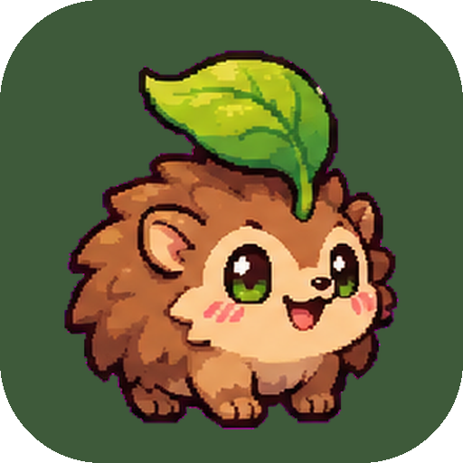
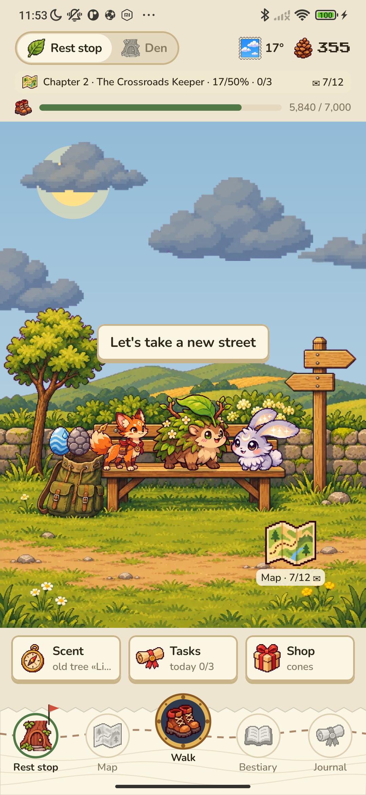
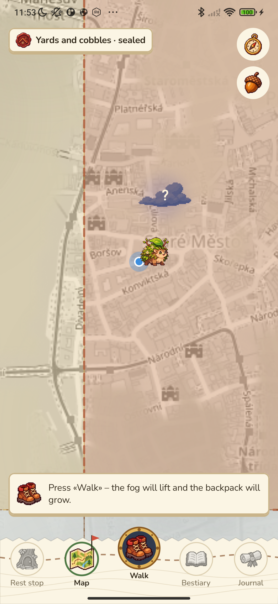
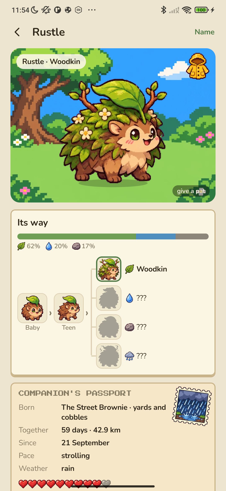
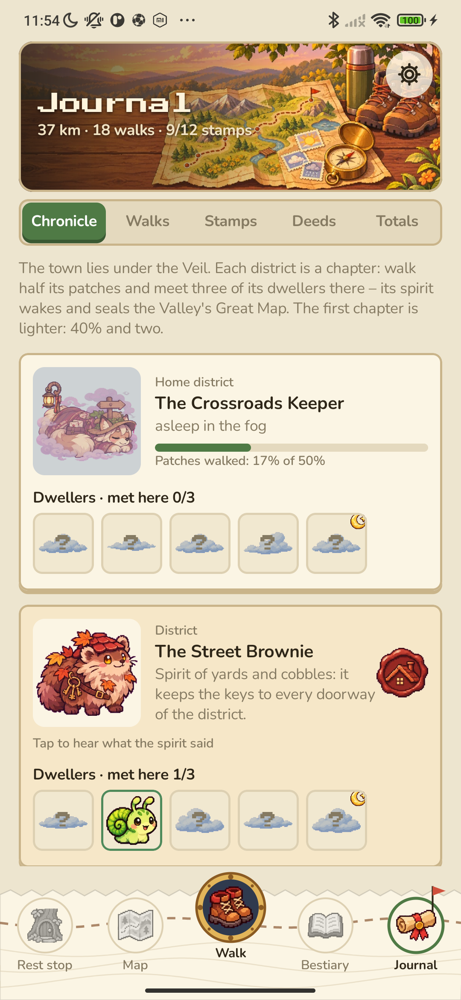

<p align="center"></p>

<h1 align="center">Roamling</h1>

<p align="center">Walk your town, lift the fog and raise little companions.<br>
<a href="https://bigdevwhale.github.io/stillcraft/apps/roamling/">Website</a> · <a href="https://github.com/bigdevwhale/roamling/releases/latest/download/Roamling.apk">Download APK</a> · <a href="README.ru.md">Русский</a></p>

Your town lies almost all under fog – the Veil, where streets nobody walks go dark. You can only go out into it with a companion: a little creature that grows as you walk. The fog lifts where you pass, eggs turn up in it, and wild companions come by themselves, each in its own weather. What a teen grows into depends on where you walked it: parks, water, old yards, hills, night or rain.

<p align="center">




</p>

## What's inside

- **70 species and nearly 200 grown forms.** Three starters, woodland, water, town, hill, night, weather and season creatures, and two legends. Unknown ones show only as silhouettes.
- **Fog over a real map.** The town is cut into patches of about 100 m. A new patch feeds the companions five times more than ordinary steps.
- **The taste of places.** OpenStreetMap tells parks, water, old streets and hills apart. Whatever leads in a teen's diet decides its grown form.
- **Real weather.** Rain, fog, blizzard, heat, storm, rainbow – each has its own wild companions, and the sky over the rest stop is the one outside. Every walk gets a stamp of its weather.
- **A story.** The town's districts are chapters. Walk a district, meet its dwellers, and its spirit wakes. On the way come letters from the First Walker, who once covered the town in fog.
- **The nose.** Once a day the leader picks up a scent to a real place nearby – a fountain, an old tree, a bridge – with a find waiting there.
- **Every day and every week** – three tasks each and the leader's wish. A backpack for three, eggs warming in its pockets, a den under the old oak.
- **Only steps on walks count:** from the phone's sensor, and if you like from your watch through Health Connect.
- **Postcards and moving.** Share your road, a companion, a walk with its route, the bestiary or the stamps as a postcard; save all the progress to one file and load it on a new phone.
- Nobody dies or gets ill: a missed day is just a rest in the den. Light and dark themes, Russian and English.

## Install

Download [Roamling.apk](https://github.com/bigdevwhale/roamling/releases/latest/download/Roamling.apk) on a phone with Android 9 or later, open it and allow installs when Android asks.

## Privacy

No ads, no account, no analytics. Walks, routes and companions stay on your phone. Only map tile, weather and OpenStreetMap requests go online, with rough coordinates and nothing about you. See [PRIVACY.md](PRIVACY.md).

## Build

JDK 17+ (Android Studio's JBR works) and the Android SDK.

```
./gradlew assembleDebug
./gradlew assembleDebug -Pdemo -Pdemolang=ru   # app.roamling.demo: two months of walks in Prague
./gradlew testDebugUnitTest -Prender --tests '*RenderScreens*'   # screens to app/build/art
```

Kotlin, Jetpack Compose, Room, DataStore, WorkManager, osmdroid. GPS handling and the fog come from [Fogwalk](https://github.com/bigdevwhale/fogwalk). The creature, scene and item art was made with AI image generation (`tools/gen_art.py`, `tools/cut.py`).

## License

MIT, see [LICENSE](LICENSE).

Roamling is one of the [StillCraft](https://bigdevwhale.github.io/stillcraft/) apps.
