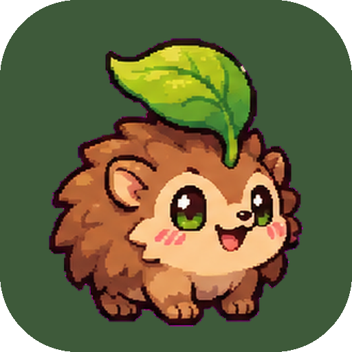
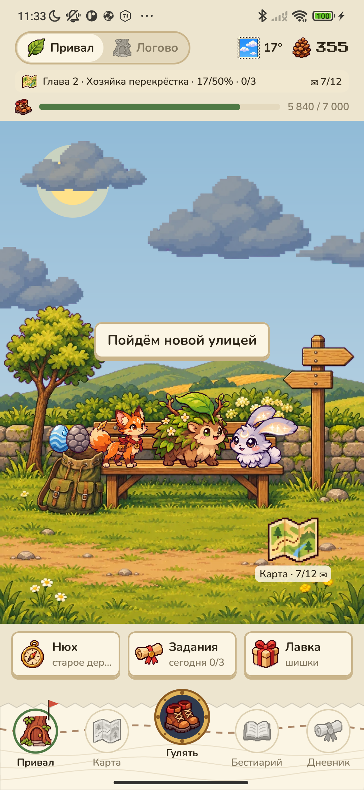
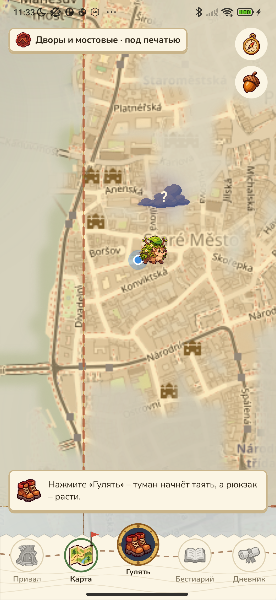
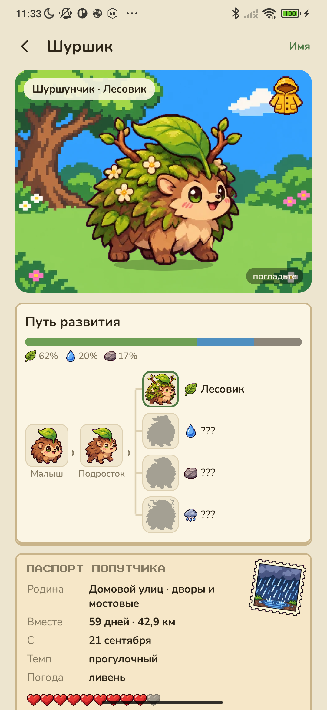
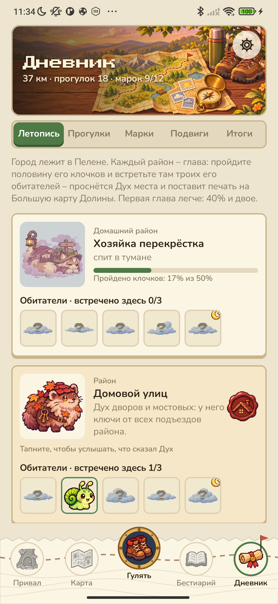

<p align="center"></p>

<h1 align="center">Попутчики</h1>

<p align="center">Гуляйте по городу, рассеивайте туман и растите маленьких попутчиков.<br>
<a href="https://bigdevwhale.github.io/stillcraft/apps/roamling/">Сайт</a> · <a href="https://github.com/bigdevwhale/roamling/releases/latest/download/Roamling.apk">Скачать APK</a> · <a href="README.md">English</a></p>

Ваш город почти весь укрыт туманом – Пеленой, в которой гаснут улицы, где никто не ходит. Выйти в неё можно только с попутчиком: маленьким существом, которое растёт от ваших прогулок. Туман тает там, где вы проходите, в нём находятся яйца, а дикие попутчики появляются сами – каждый в свою погоду. Из чего вырастет подросток, зависит от того, где вы с ним гуляли: в парке, у воды, по старым дворам, по холмам, ночью или под дождём.

<p align="center">




</p>

## Что внутри

- **70 видов и почти 200 взрослых форм.** Три стартовых, лесные, речные, городские, обитатели холмов, ночные, погодные, сезонные и двое легендарных. Неизвестные видны только силуэтом.
- **Туман над настоящей картой.** Город поделён на клочки примерно по 100 м. Новый клочок кормит попутчиков в пять раз сытнее обычных шагов.
- **Вкус мест.** Из OpenStreetMap приложение узнаёт, где парки, вода, старые улицы и холмы. Чего больше в рационе подростка, такой взрослой формой он и станет.
- **Настоящая погода.** Дождь, туман, метель, жара, гроза, радуга – у каждой свои дикие попутчики, а небо над привалом такое же, как за окном. Каждая прогулка получает марку своей погоды.
- **Сюжет.** Районы города – главы. Пройдите район, встретьте его обитателей, и проснётся Дух места. А по пути приходят письма Первого путника, который когда-то укрыл город туманом.
- **Нюх.** Раз в день вожак берёт след к настоящему месту рядом – фонтану, старому дереву, мосту, – а там ждёт находка.
- **Каждый день и каждую неделю** – по три задания и желание вожака. Рюкзак на троих, яйца греются в карманах, логово под старым дубом.
- **Шаги считаются только на прогулках:** с датчика телефона, а если хотите – ещё и с часов через Health Connect.
- **Открытки и переезд.** Итоги пути, попутчик, прогулка с маршрутом, бестиарий или марки – открыткой, чтобы поделиться. Весь прогресс сохраняется в один файл и загружается на новом телефоне.
- Никто не умирает и не болеет: пропущенный день – просто отдых в логове. Светлая и тёмная темы, русский и английский.

## Установка

Скачайте [Roamling.apk](https://github.com/bigdevwhale/roamling/releases/latest/download/Roamling.apk) на телефон с Android 9 или новее, откройте файл и разрешите установку, когда Android спросит.

## Конфиденциальность

Без рекламы, аккаунтов и аналитики. Прогулки, маршруты и попутчики хранятся только на телефоне. В сеть уходят лишь запросы плиток карты, погоды и OpenStreetMap – с примерными координатами, без чего-либо о вас. Подробнее – в [PRIVACY.md](PRIVACY.md).

## Сборка

Нужны JDK 17+ (подойдёт JBR из Android Studio) и Android SDK.

```
./gradlew assembleDebug
./gradlew assembleDebug -Pdemo -Pdemolang=ru   # app.roamling.demo: два месяца прогулок по Праге
./gradlew testDebugUnitTest -Prender --tests '*RenderScreens*'   # экраны в app/build/art
```

Kotlin, Jetpack Compose, Room, DataStore, WorkManager, osmdroid. Работа с GPS и туман взяты из [Fogwalk](https://github.com/bigdevwhale/fogwalk). Существа, сцены и вещи нарисованы с помощью генерации изображений (`tools/gen_art.py`, `tools/cut.py`).

## Лицензия

MIT, см. [LICENSE](LICENSE).

Попутчики – одно из приложений [StillCraft](https://bigdevwhale.github.io/stillcraft/).
